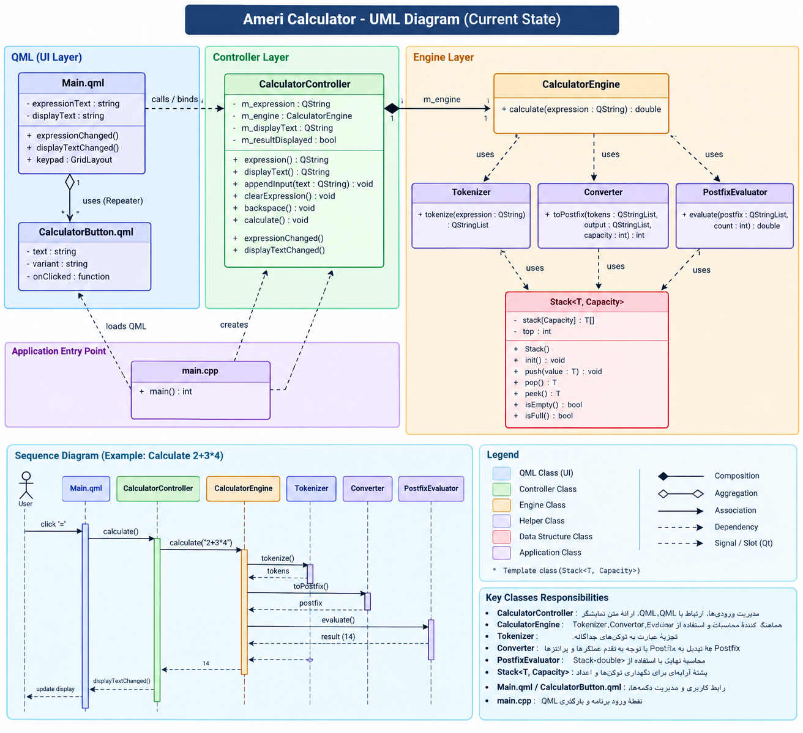

# Ameri Calculator

پروژه دانشگاهی درس [ساختمان داده] - یک ماشین‌حساب دسکتاپ حرفه‌ای که با زبان **C++**، فریم‌ورک **Qt** و رابط کاربری **QML** پیاده‌سازی شده است.

**نام و نام خانوادگی:** امیرحسین عرب عامری  

---

##  ویژگی‌های پروژه
- **رابط کاربری مدرن:** استفاده از QML برای طراحی یک UI واکنش‌گرا و زیبا.
- **موتور محاسباتی اختصاصی:** پشتیبانی از اولویت عملگرها (Parentheses, Multiplication, etc.).
- **ساختار داده سفارشی:** پیاده‌سازی کلاس `Stack<T, Capacity>` به صورت Template و Generic با ظرفیت مشخص.
- **الگوریتم‌های پردازش رشته:** تبدیل عبارات ریاضی از Infix به Postfix و ارزیابی آن‌ها.

---

##  معماری پروژه (UML)
پروژه با یک معماری لایه‌ای (MVC-like) تمیز طراحی شده است:

- **QML (UI Layer):** شامل `Main.qml` و `CalculatorButton.qml` برای نمایش صفحه‌کلید و دریافت ورودی‌های کاربر.
- **Controller Layer:** کلاس `CalculatorController` به عنوان پل ارتباطی بین UI و منطق برنامه عمل می‌کند.
- **Engine Layer:** کلاس `CalculatorEngine` که وظیفه هماهنگی بین کلاس‌های `Tokenizer` (جداسازی توکن‌ها)، `Converter` (تبدیل به Postfix) و `PostfixEvaluator` (محاسبه نهایی) را بر عهده دارد.

---

##  نحوه اجرا (Build & Run)

**پیش‌نیازها:**
- Qt 6.x (یا Qt 5.15)
- CMake
- کامپایلر C++ (مانند MinGW یا MSVC)

**مراحل اجرا در Qt Creator:**
1. پروژه را دانلود (یا Clone) کنید.
2. در **Qt Creator**، از منوی بالا گزینه **File -> Open File or Project** را انتخاب کنید.
3. وارد پوشه پروژه شوید و فایل **`CMakeLists.txt`** را انتخاب و باز کنید.
4. در پنجره‌ای که باز می‌شود (Configure Project)، دکمه **Configure Project** را بزنید.
5. دکمه **Build** (آیکون چکش) و سپس **Run** (آیکون مثلث سبز) را بزنید تا برنامه اجرا شود.
